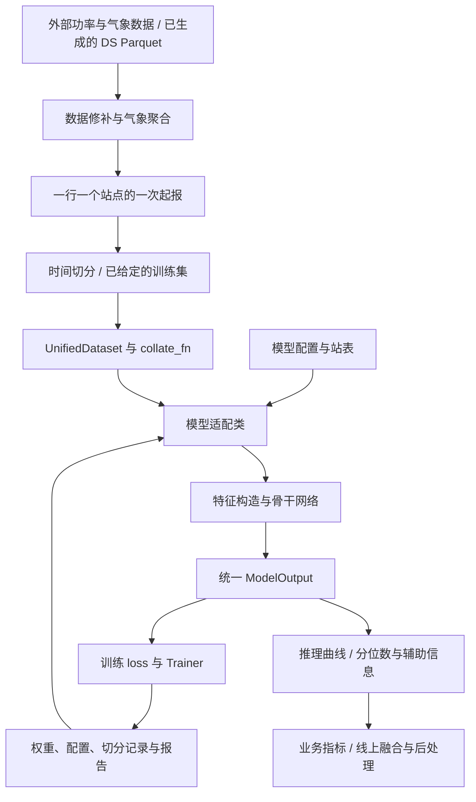

# NextGenPVForecast 架构基线分析

分析日期：2026-10-15。依据当前工作区源码，Git HEAD 为 `0c62ea8`；工作区存在脚本迁移、修改和未跟踪文件，因此本文不等同于该提交的架构说明。此次只新增本文档，没有修改训练、推理或模型实现。

## 1. 总体判断

项目采用“统一数据与模型接口 + 按目录发现模型 + 模型自治的训练编排 + 业务侧推理集成”的设计。

稳定的公共边界是 DS 行表、`UnifiedDataset`、`forward(batch_dict, labels=None)` 和 `TransformersAdaptedModelOutput`。网络、特征工程、损失及复杂训练协议主要放在各模型目录内。

训练入口并未完全统一：M4 走公共 `train_model`，M6/M8 有独立 `train.py`。后两者底层仍使用 Hugging Face `Trainer` 子类与 callback，并非自行实现完整优化器循环。目录自治允许快速试验，但也带来配置、站表和辅助代码的重复。

当前本地包含 M4–M8。注册表中的 M1/M2/M3、异构融合和天气融合是历史兼容或扩展接口，相关实现未包含在本目录中。线上编排也依赖外部工程与服务器资源：应区分“业务工程的架构组成”与“这一份目录可独立执行的范围”。

## 2. 分层与职责

| 层 | 主要位置 | 实际职责 |
|---|---|---|
| 启动与任务编排 | `train_shell/`、`eval_shell/` | 解释器、GPU、Accelerate、多变体/多种子排队、输出路径 |
| 数据协议 | `pipelines/transformer_dataset.py` | DS 行表到 sample/batch，时间戳、数值类型、标签分离、实体对齐 |
| 数据切分 | `pipelines/time_splits.py`、`configs/`、`data/splits/` | 按站时间边界、验证块、purge/embargo、整站留出和 manifest |
| 模型发现 | `pipelines/model_registry.py` | 按目录懒发现模型类与 evaluator，兼容历史别名 |
| 输出协议 | `interfaces/modeloutput.py` | loss/logits/predictions/embeddings/aux 的公共容器 |
| 模型实现 | `forecast_backbones/m4` 至 `m8` | 模型特征转换、网络、损失、配置、评估适配 |
| 通用推理 | `pipelines/pipeline_wrapper_inference.py` | 稳定行序的批量推理、逐样本降级、实体与曲线回填 |
| 业务指标 | `pipelines/metric.py`、`pipelines/nanwang_metric.py` | 多口径短期/超短期指标、按日和按月报告 |
| 线上编排 | `nanwang_online/` | 外部数据获取、修补、气象聚合、站级/省级模型、融合与交付 |
| 协变量试验 | `experiments/nwp_covariate/` | 字段白名单、特征组合、LightGBM 粗排、M5 精排与缓存 |



图中的原始数据读取与部分修补位于外部业务工程，不是全部由本仓库实现。

## 3. 数据契约

基本单元不是一个时间点，而是一个预测样本：`(timestamp_win, station 或 station_id)` 对应一条完整历史和未来窗口。

常用时间几何是每 15 分钟一步，历史 672 步（7 天）、未来 192 步（2 天）。历史最后一步对应起报时刻；未来第一步是起报后 15 分钟。线上短期还会通过外部 `rolling_inference` 扩展到 480 步，因此不能把 192 写成整个业务系统唯一支持的长度。

| 字段类型 | 典型列 | 单行含义 |
|---|---|---|
| 起报时间 | `timestamp_win` | 标量时间戳，batch 常用 epoch 秒 |
| 实体 | `station`、`station_id` | 站名/整数站号；必须明确映射关系 |
| 历史目标 | `observe_power` | 通常 672 点 |
| 历史气象 | `general_ghi`、`general_temp` 等 | 通常 672 点；是否为实测或历史预报由上游定义 |
| 未来气象 | `general_ghi_predict` 等 | 通常取未来 192 点，必须为起报时刻可得数据 |
| 模型提示 | `timesfm3` 等 | 未来预测曲线，不能用未来实测替代 |
| 标签 | `observe_power_future` | 未来真值，仅供损失与评估 |

训练 batch 的实际结构为：

```python
{
    "batch_dict": {
        "timestamp_win": ..., "station_id": ...,
        "observe_power": ..., "general_ghi_predict": ..., "index": ...,
    },
    "labels": {"observe_power_future": ...},
}
```

`UnifiedDataset` 支持 DataFrame 的 NumPy 后端，以及 Parquet/Hugging Face Dataset 的 Arrow 后端。后者减少全表物化，但站号补齐、拼表、按列访问等路径仍可能物化数据，不能把整条流程理解为恒定内存。序列列需要定长，不支持任意变长样本。

`collate_fn` 默认可丢弃字符串，通用推理显式保留字符串以回填站名；M6/M8 训练提前将站名映射成整数站号。公共 Dataset 的 entity 定位和模型消费的 station_id 是不同用途。

注意：`unified_inference` 不自动指定标签列；`feature_cols=None` 时会推断剩余列。因此调用方应显式指定特征或剔除标签，不能依赖通用包装器自动阻止未来真值进入 `batch_dict`。M8 自有 evaluator 额外移除了标签键。

## 4. 模型插件契约

发现顺序为 `forecast_backbones/<name>` → `hetero_fusion/<name>` → `weather_fusion/<name>` → 旧注册表。只解析当前请求的模型，不在 import 时扫描和加载全部底座。

一个可接入模型至少需要：

1. `transformer_models.py` 中第一个“在该模块定义的 nn.Module 子类”是对外适配类。
2. 构造方法接受配置字典；`forward(batch_dict, labels=None)` 返回公共输出容器。
3. `.logits` 是可交付的真实功率单位曲线，常见形状 `[B, H]`；公共推理实际读取此字段，而不是 `.predictions`。
4. 训练时提供可反向传播的 `.loss`；配置通过 `.config` 或模型自身保存逻辑落盘。
5. `transformer_trainer.py` 暴露 `evaluate_model(model, test_dataset, HF_collate_fn, config)`。
6. 配置放在模型目录；复杂训练可另提供 `train.py`。

这里是约定驱动的插件结构，没有统一抽象基类或完整 schema 校验。自动选择第一个类很方便，但如果把辅助 nn.Module 放到适配类之前，会改变发现结果。`list_models()` 仅含历史注册和已访问过的自动发现缓存，也不能当作完整可用模型清单。

`ModelOutput` 的文字注释偏通用分类任务；实际 PV 语义以调用代码为准。尤其 M8 的 logits 已过非可微决策层，训练梯度来自原始分位的 loss，不能对 logits 重新计算损失来替代既有训练路径。

## 5. 当前模型定位

| 模型 | 当前代码路线 | 架构特点 |
|---|---|---|
| M4 | PatchTST 监督训练 | 历史/未来天气与历史功率/外部预测拼接，RevIN，模型内 feature collator 与损失 |
| M5 | TimesFM-3 零样本适配 | 可传历史/未来成对协变量，点预测/分位输出；保留 `TransformersAdaptedTimesFM3Model` 别名；另有 conformal replay |
| M6 | TimesFM-3 零样本与 LoRA | 可微底座封装、LoRA、站表、太阳几何、分位校准、决策和业务指标 callback |
| M7 | PatchTST-FM-r2 零样本适配 | 历史功率输入，底座按需加载，对齐框架的点预测/分位输出 |
| M8 | PVRex 从零训练 | 容量归一、NWP 和太阳几何、patch 编码、卷积/DeltaNet 混合器、分位损失及独立决策 |

M5 的 LoRA 自包含重构存在于 `docs/superpowers/specs/2026-10-14-m5-lora-finetune-design.md`，但设计列出的 `m5/train.py`、`m5/lora.py`、`config/finetune.yaml` 等尚不在当前文件树。不能把设计文档描述当成已实现能力。

M8 的结构最清晰地体现当前迭代方式：

```text
FeatureBuilder：历史目标 + 缺测/掩码 + NWP + 太阳/时间 + 静态站信息 + 可选未来提示
  → patch 展平与 MLP 编码 + 静态投影 + 站点/位置嵌入
  → conv / deltanet 等混合块
  → 每步隐状态 + patch 内位置 + 该步协变量，再进入输出头
  → 原始分位 q
  → 分位排序 / 容量与晴空约束 / median 或 p* 选点
  → logits
```

它把“网络预测分布”和“如何提交一条曲线”分开。`predict_raw()` 可用于多个 checkpoint 的原始分位平均，再统一决策；不等同于简单平均最终 logits。晴空/夜间规则是模型假设与可配置策略，评价时应单独记录，不能当成所有电站都严格成立的物理真值。

训练增强包括历史段遮盖 CPM、协变量 dropout、未来提示 dropout、站点槽 dropout、幅度调制。训练集站号保存为 `known_stations`，新站使用未知站槽，并在报告中分开 seen/unseen。

`config/variants/j1_final2.yaml` 是当前文档描述的组合候选：晴空出力比、缺坐标站历史包络、TimesFM 未来提示及分段决策。其默认值来自 `config.py::DEFAULT_CFG` 深合并，不是自动继承 `config/configs.yaml`；修改 YAML 默认文件不意味着所有变体都会同步改变。

## 6. 训练、切分和实验闭环

公共训练链：`train_shell/train_script.py` → 构造配置/数据/模型 → `pipelines.transformer_trainer.train_model` → HF Trainer → 权重与配置。

模型自治链：`train_shell/train_m6.sh` / `train_m8.sh` → 对应 `train.py` → HF Trainer 子类 + 业务 callback。M6 涉及可选校准集、最优 LoRA 和训后校准；M8 支持业务早停、EMA、平滑选点、多种子、refit 和集成评估。

公共 `train_model` 实际实例化的是 `Trainer`，同文件定义的 `FrameworkTrainer` 没有被此函数使用。因此通用训练依赖 `forward(..., labels=...)` 产出 loss，不能仅凭文件注释认为一定调用模型 `compute_loss` 委托接口。

切分应保留时间依赖：672 步历史和 192 步标签意味着随机按行划分会产生大量重叠窗口。`time_splits.py` 支持日历验证块、按站测试起点、块前 purge、块后 embargo、短站仅训练和整站验证。当前典型配置块前剔除 2 天、块后合计 9 天；实际边界应以 resolved 配置和 manifest 为准。

M8 有三种不同语义：

- 验证模式：读取已有 train/valid/manifest，选择配方和 checkpoint。
- `--refit`：固定步数，合并已有 train/valid；无法恢复之前切分时已丢弃的隔离行。
- `--train_parquet`：直接使用给定训练文件，固定步数，无验证、不自动切分或剔除行。训练/测试隔离责任在输入数据准备阶段。

`m8_refit.yaml` 和 `m8_all.yaml` 不能混为同一评测协议：后者配置注释明确允许全量数据，可能与测试期重合。公平比较应固定数据版本、站点集合、时间边界、特征生成版本、种子、训练预算与后处理。

M8 的典型产物包括 `model.safetensors`、`model_config.yaml`、`split_manifest.json`、`train_log.json`、验证/测试结果 Parquet 和 `reports/`。全量 refit 的验证分数为空是预期行为。权重加配置用于推理，并不自动等于含优化器状态的精确断点续训 checkpoint。

## 7. 推理与评估的边界

通用推理保持输入行顺序，以类名作为预测列名；批量失败时逐样本重试，仍失败的行填 `None`。这适合业务容错，但训练/回归验收必须统计失败行，避免“函数返回了 DataFrame”被误判为成功。

模型 evaluator 输出评估用长信息表；业务评分由指标模块完成。南网 D+1 使用起报日下一整天，在 10:00 起报时对应未来数组 `[55:151]`。公共 `NanwangMetric` 对缺失 10:00 行允许回退到当日更早行，M8 快速验证还有自己的行筛选规则，因此跨入口比较要核对有效样本。

M8 快速评估中的 `nanwang_ultra_proxy` 是超短期代理指标，不应写成完整官方超短期成绩。`eval_shell/eval_m8.sh --full` 通过站级报告路径输出完整指标与逐行结果。

线上 `MultiInfer` 除调用模型外，还负责历史修补、气象聚合、多模型/站省级组合、滚动预测和结果后处理。它当前直接构造 M1/M5 等业务模型，并非全部经过 registry。线上策略与离线模型本体要分别版本化，不能只比较网络参数就认定两条流程等价。

## 8. 已确认的本地完整性问题

以下是基于当前源码和文件树的结论，没有在本次顺带修复：

| 问题 | 证据 | 影响 |
|---|---|---|
| M8 默认 YAML 与校验冲突 | `config/configs.yaml` 含 `features.nwp_members`、`model.layout/head_mode/bidirectional`；`config.py::_check_removed` 禁止这些键 | 使用该 YAML 的默认入口会在配置阶段失败；不代表所有变体配置都失败 |
| 通用 shell 指向旧脚本位置 | `train_shell/train_shell.sh` 调用根目录 `train_script.py`，实际在 `train_shell/` | 默认启动路径不成立 |
| 通用 Python 入口的基目录未随迁移调整 | `train_script.py::BASE_PATH` 是当前脚本父目录，仍从其下查 `forecast_backbones` | 未显式传配置时查找路径错误 |
| 公共训练辅助模块缺失 | 公共 trainer 与入口引用 `pipelines.transformer_utils`，目录中不存在 | 本地公共训练导入链不完整 |
| 部分历史模型/评估依赖缺失 | M4 引用 M1 的损失；`eval_pretrain.py` 引用根目录 `eval_station_script` | 相关入口依赖外部文件或补齐工程内容 |
| 线上环境依赖未随本目录提供 | `multi_infer.py` 引用外部 ODS/ETL、M1、`rolling_wrapper_inference`，并写有服务器绝对路径 | 此目录无法单独证明生产端到端可执行 |
| 缺少根级依赖清单 | 当前文件树未见 requirements/pyproject/锁文件 | 本地与训练服务器版本一致性难以自动复现 |

此外，文档/注释中仍有根目录旧 shell 命令、已删除分支说明和旧夜间行为描述。站表在 M6/M8 各有一份，实验目录也复制了指标实现；这是为自包含作出的取舍，后续需要一致性检查。

## 9. 后续开发遵循的工作约定

建议保留公共边界，优先在单个模型目录内迭代；复杂训练延续 M8 的编排方式，但不要直接复制尚未修正的默认配置和入口路径。

新增模型/改模型时先明确输入列、时间单位、历史/未来长度、容量来源、站号映射、缺测语义与输出真实单位。将 labels 和预测特征严格分开；外部提示必须保证训练与线上生成方式相同。

实验分开记录网络、特征、训练协议和决策规则；尽量单因素变体，多种子看稳定性。先在验证集选择配方/步数，再 refit 和固定测试；比较基础模型与业务整链时单独报告后处理贡献。

最小验证顺序：配置与导入 → 合成 batch 前向/反向 → 标签不泄漏/缺测/站号/时间对齐 → 权重保存重载一致 → 小样本训练 → 固定数据切分上的多种子比较 → 线上入口回归。真实底座测试与 mock 测试分开记录，CPU 单测通过不能代替 GPU、真实权重及生产数据验证。

建议开始下一轮实际开发前先收敛默认配置、启动路径、缺失依赖和环境清单，以形成可重复执行的基线；本次分析不擅自扩大为重构任务。

## 10. 本次核验范围

- 完成公共接口、模型注册、数据读取、训练编排、推理包装、时间切分、指标、M4–M8 适配、线上调用与 NWP 实验路径的源码分析。
- 125 个 Python 文件通过 AST 语法解析；8 个 shell 文件通过 `bash -n`。语法通过不代表依赖和运行逻辑正确。
- 静态统计 339 个 `test_*` 函数：M5 11、M6 187、M7 7、M8 76、公共切分 38、NWP 实验 20；不含参数化展开，不能当作本次 pytest 通过数。
- 用标准库独立执行 M8 的原始禁用键检查函数，复现默认 YAML 对应四个字段被拒绝；未执行完整 YAML 加载与模型构建。
- 当前默认 `python3` 是系统 Python，探测不到 torch/transformers/numpy/pandas/pyarrow/datasets/pytest/safetensors/yaml/accelerate。本次没有安装依赖、加载真实权重、执行 pytest 或启动训练；其他解释器与服务器环境未验证。
- 未对 README 中历史实验成绩进行重跑，因此本文不据此宣称某模型效果更优。
